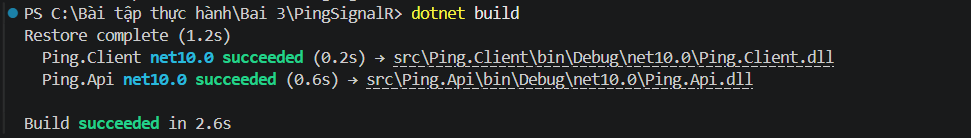
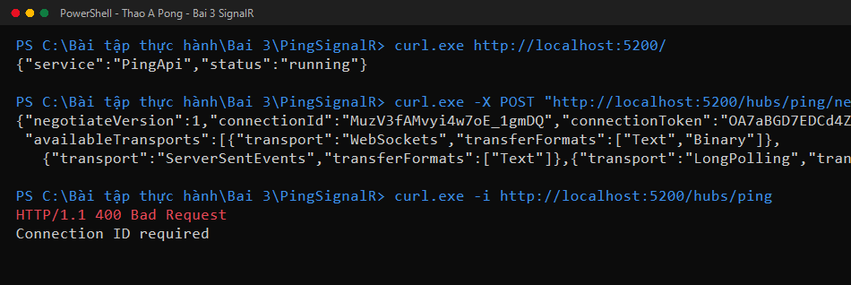
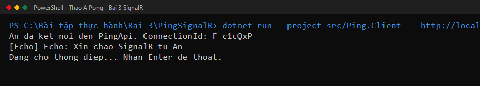
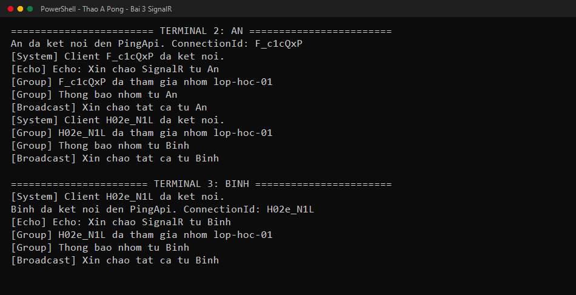
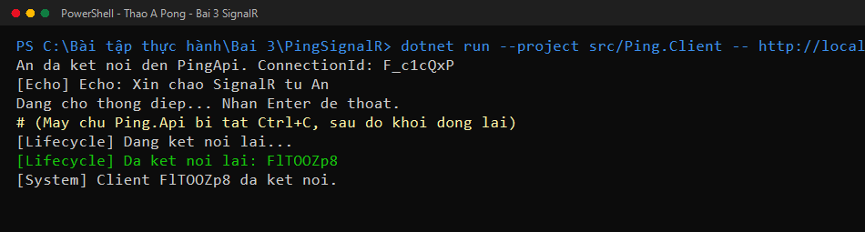
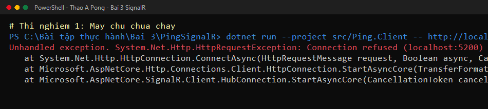
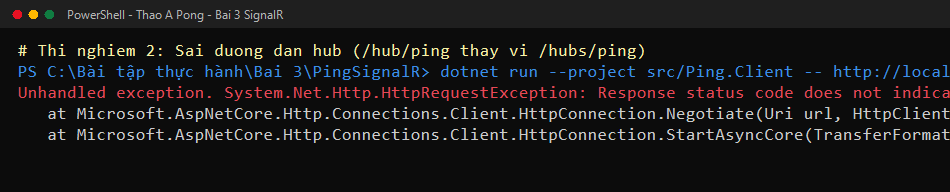
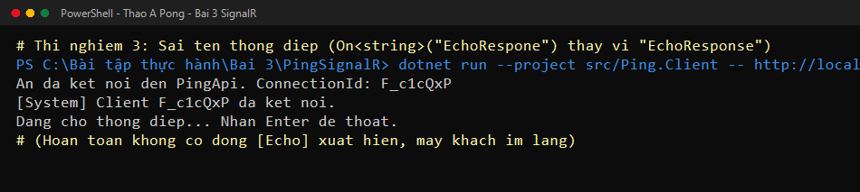
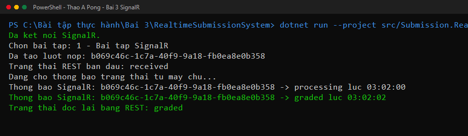
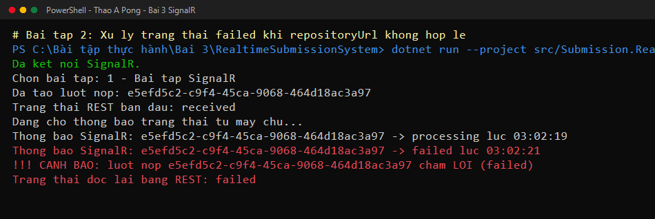

# BÁO CÁO BÀI TẬP THỰC HÀNH BÀI 3
## GIAO TIẾP THỜI GIAN THỰC VỚI SIGNALR: TỪ PINGSIGNALR ĐẾN EDUSUBMIT REALTIME

- **Học phần:** Phát triển ứng dụng phân tán
- **Giảng viên hướng dẫn:** TS. Dương Thu Mây (Email: dtmay@ictu.edu.vn - ĐT: 0989086222)
- **Sinh viên thực hiện:** Thào A Póng
- **Mã sinh viên:** DTC245200592
- **Lớp:** CNTT K23E
- **Trường Đại học Công nghệ Thông tin và Truyền thông (ICTU) - Đại học Thái Nguyên**

---

## MỤC LỤC
1. [Trả lời 3 câu hỏi đầu giờ](#1-trả-lời-3-câu-hỏi-đầu-giờ)
2. [Cấu trúc thư mục dự án](#2-cấu-trúc-thư-mục-dự-án)
3. [Phần 1: Dự án PingSignalR (7 bước kèm ảnh minh chứng)](#3-phần-1-dự-án-pingsignalr-7-bước-kèm-ảnh-minh-chứng)
4. [Phần 2: Dự án EduSubmit Realtime (RealtimeSubmissionSystem)](#4-phần-2-dự-án-edusubmit-realtime-realtimesubmissionsystem)
5. [Phần 3: Bảng 5 thí nghiệm phân tán (Bước 7)](#5-phần-3-bảng-5-thí-nghiệm-phân-tán-bước-7)
6. [Phần 4: Kiểm tra 9 ca trong requests.http](#6-phần-4-kiểm-tra-9-ca-trong-requestshttp)
7. [Phần 5: Vận dụng nâng cao (Bài tập 2 & Bài tập 3)](#7-phần-5-vận-dụng-nâng-cao-bài-tập-2--bài-tập-3)
8. [Phần 6: Ôn tập và thảo luận chuyên sâu](#8-phần-6-ôn-tập-và-thảo-luận-chuyên-sâu)

---

## 1. Trả lời 3 câu hỏi đầu giờ

### Câu 1: Máy chủ có thể chủ động báo cho máy khách mà không cần máy khách hỏi không?
- **Trả lời:** **CÓ**. Máy chủ hoàn toàn có thể chủ động đẩy thông điệp tới máy khách nếu máy khách duy trì một kết nối hai chiều luôn mở (persistent full-duplex connection) tới máy chủ thông qua giao thức **WebSocket** (được đóng gói cấp cao bởi thư viện **SignalR**).
- Phía máy chủ gửi thông điệp bằng cú pháp `Clients.Caller.SendAsync`, `Clients.Group(...).SendAsync` hoặc `Clients.All.SendAsync`. Khi cần gửi từ bên ngoài lớp Hub (ví dụ: endpoint Minimal API hoặc tác vụ nền `Task.Run`), ta inject dịch vụ `IHubContext<THub>`.

### Câu 2: Đã có REST rồi, vì sao còn cần thêm SignalR? Hai thứ chia việc thế nào?
- **Trả lời:**
  - **REST (Yêu cầu – Phản hồi):** Là **nguồn sự thật (Source of Truth)**. Phù hợp nhất cho việc tạo tài nguyên (`POST` trả về `201 Created`), kiểm tra nghiệp vụ hợp lệ/lỗi (`400 Bad Request`, `404 Not Found`), và truy vấn trạng thái hiện tại (`GET`). Tuy nhiên, HTTP thông thường chỉ cho phép máy khách mở lời; nếu trạng thái tài nguyên thay đổi sau đó, máy khách phải dùng Polling (thăm dò liên tục), gây lãng phí tới 93% tài nguyên mạng và luôn có độ trễ.
  - **SignalR (Đẩy dữ liệu thời gian thực - Server Push):** Bổ sung chiều giao tiếp từ máy chủ về máy khách. Ngay khi có sự kiện (ví dụ: bài nộp chuyển sang `processing` rồi `graded`), máy chủ chủ động đẩy thông báo tức thì tới đúng máy khách quan tâm mà không cần máy khách phải hỏi.
  - **Quy tắc chia việc:** REST tạo và lưu trữ tài nguyên; SignalR thông báo các thay đổi phát sinh; khi mất kết nối hoặc cần kiểm chứng trạng thái cuối cùng, máy khách luôn gọi lại REST để đối chiếu.

### Câu 3: Nếu đứt mạng đúng lúc máy chủ báo "đã chấm xong" (graded) thì sao?
- **Trả lời:**
  - Thông điệp đó sẽ **bị mất** vì SignalR hoạt động theo cơ chế đẩy thời gian thực và mặc định không lưu trữ hàng đợi tin nhắn chưa gửi (no built-in message queue persistence).
  - Tuy nhiên, cấu hình `WithAutomaticReconnect()` ở máy khách sẽ tự động thử kết nối lại theo chu kỳ (0s, 2s, 10s, 30s). Sau khi kết nối lại thành công, máy khách nhận được một `ConnectionId` mới.
  - **Biện pháp cứu vãn:** Theo nguyên tắc vàng *"REST là nguồn sự thật"*, sau khi kết nối lại hoặc sau thời gian chờ (timeout), máy khách thực hiện gọi `GET /api/submissions/{id}` qua kênh REST để lấy trạng thái chính xác nhất hiện tại được lưu trong cơ sở dữ liệu / bộ nhớ máy chủ.

---

## 2. Cấu trúc thư mục dự án

```
Thào A Póng - dtc245200592/
└── Bai3/
    ├── README.md
    ├── anh/
    │   ├── buoc1-build.png
    │   ├── buoc2-negotiate.png
    │   ├── buoc4-echo.png
    │   ├── buoc5-nhom.png
    │   ├── buoc6-noilai.png
    │   ├── buoc7-loi1.png
    │   ├── buoc7-loi2.png
    │   ├── buoc7-loi3.png
    │   ├── edusubmit-client.png
    │   └── edusubmit-failed.png
    ├── PingSignalR/
    │   ├── PingSignalR.slnx
    │   ├── .gitignore
    │   └── src/
    │       ├── Ping.Api/
    │       │   ├── Ping.Api.csproj
    │       │   └── Program.cs
    │       └── Ping.Client/
    │           ├── Ping.Client.csproj
    │           └── Program.cs
    └── RealtimeSubmissionSystem/
        ├── RealtimeSubmissionSystem.slnx
        ├── requests.http
        ├── nop-bai.json
        ├── .gitignore
        └── src/
            ├── Submission.RealtimeApi/
            │   ├── Submission.RealtimeApi.csproj
            │   └── Program.cs
            └── Submission.RealtimeClient/
                ├── Submission.RealtimeClient.csproj
                └── Program.cs
```

---

## 3. Phần 1: Dự án PingSignalR (7 bước kèm ảnh minh chứng)

### Hợp đồng giao tiếp (Hub Contract)
| Phía gọi | Tên phương thức / Thông điệp | Phạm vi gửi | Ý nghĩa |
|---|---|---|---|
| Client -> Hub | `Echo(message)` | `Clients.Caller` | Máy chủ gửi lại `EchoResponse` riêng cho người gọi |
| Client -> Hub | `Broadcast(message)` | `Clients.All` | Máy chủ gửi `BroadcastMessage` tới tất cả các client đang mở |
| Client -> Hub | `JoinGroup(groupName)` | `Clients.Group` | Máy chủ thêm vào nhóm, gửi `GroupMessage` báo cho cả nhóm |
| Client -> Hub | `SendToGroup(group, msg)`| `Clients.Group` | Gửi `GroupMessage` tới các client trong nhóm đó |
| Hệ thống | `OnConnectedAsync` / `OnDisconnectedAsync` | `Clients.All` | Tự động phát `SystemMessage` khi có client nối / ngắt |

### 4 Phạm vi gửi trong SignalR
1. **`Clients.Caller`**: Chỉ gửi về duy nhất kết nối vừa gọi phương thức Hub. Không làm phiền các client khác.
2. **`Clients.All`**: Gửi tới tất cả các client đang kết nối đến Hub, bao gồm cả người vừa gọi.
3. **`Clients.Group(groupName)`**: Chỉ gửi tới những client đã tham gia vào nhóm `groupName` thông qua `Groups.AddToGroupAsync`.
4. **`Clients.Client(connectionId)`**: Gửi trực tiếp tới một kết nối cụ thể bằng ID.

---

### Ảnh minh chứng từng bước của PingSignalR

#### Bước 1: Khởi tạo solution và kiểm tra build

- **Thấy:** `Build succeeded` với 0 Warning, 0 Error.
- **Giải thích:** Tạo solution `PingSignalR`, project `Ping.Api` (web), `Ping.Client` (console) và cài đặt thành công package `Microsoft.AspNetCore.SignalR.Client` phiên bản `10.0.15`.

#### Bước 2: Bắt tay negotiate

- **Thấy:** `curl.exe` gọi `POST /hubs/ping/negotiate?negotiateVersion=1` trả về mã 200 kèm `connectionId` và danh sách 3 cơ chế truyền tải: `WebSockets`, `ServerSentEvents`, `LongPolling`.
- **Giải thích:** Bước bắt tay giúp máy khách và máy chủ thỏa thuận phiên bản giao thức và chọn kênh truyền tải tối ưu nhất.

#### Bước 3 & 4: Máy khách gọi Echo

- **Thấy:** Máy khách An kết nối thành công và nhận được dòng phản hồi `[Echo] Echo: Xin chao SignalR tu An`.
- **Giải thích:** Hub xử lý phương thức `Echo` và sử dụng `Clients.Caller.SendAsync("EchoResponse", ...)` để trả lời riêng cho máy khách vừa gọi.

#### Bước 5: Phát rộng và Nhóm

- **Thấy:** Terminal của An và Bình đều thấy tin `[Group]` và `[Broadcast]` của nhau khi cùng ở trong nhóm `lop-hoc-01`, nhưng An không nhận tin `[Echo]` riêng của Bình.
- **Giải thích:** Phân tách rõ ràng giữa phạm vi gửi `Clients.Group` (chỉ thành viên nhóm), `Clients.All` (toàn bộ kết nối) và `Clients.Caller` (chỉ người gọi).

#### Bước 6: Vòng đời kết nối và tự động kết nối lại

- **Thấy:** Khi máy chủ bị dừng tạm thời và bật lại, máy khách tự động bắt sự kiện `[Lifecycle] Dang ket noi lai...` và khôi phục `[Lifecycle] Da ket noi lai: FlTOOZp8`.
- **Giải thích:** `WithAutomaticReconnect()` kích hoạt lịch thử lại mặc định (sau 0s, 2s, 10s, 30s) và cấp `ConnectionId` mới sau khi tái kết nối.

#### Bước 7: Ba thí nghiệm lỗi điển hình
- **Lỗi 1: Máy chủ chưa chạy**
  
  *Hiện tượng:* Ném ngoại lệ `HttpRequestException: Connection refused (localhost:5200)` ngay khi gọi `StartAsync()`.
  *Bài học:* `WithAutomaticReconnect` chỉ khôi phục kết nối đã mở, không thể cứu kết nối ban đầu nếu máy chủ chưa bật.

- **Lỗi 2: Sai đường dẫn hub (`/hub/ping` thiếu `s`)**
  
  *Hiện tượng:* Báo lỗi `404 Not Found` ở bước negotiate.
  *Bài học:* Tuyến đường trong `WithUrl` phải khớp chính xác tuyệt đối với `app.MapHub<PingHub>("/hubs/ping")`.

- **Lỗi 3: Sai tên thông điệp (`EchoRespone` thiếu `s`)**
  
  *Hiện tượng:* Ứng dụng chạy bình thường, không báo lỗi ngoại lệ nhưng máy khách hoàn toàn không in ra dòng `[Echo]`.
  *Bài học:* Sai tên thông điệp ở chiều gửi xuống (Server -> Client) sẽ bị bỏ qua trong im lặng. Luôn phải đối chiếu bảng hợp đồng tên sự kiện giữa 2 phía.

---

## 4. Phần 2: Dự án EduSubmit Realtime (RealtimeSubmissionSystem)

### Bản thiết kế kênh thời gian thực theo khung 4 câu hỏi
1. **Sự kiện nào?** Trạng thái lượt nộp bài thay đổi trên máy chủ: `received` -> `processing` -> `graded` (hoặc `failed`).
2. **Gửi cho ai?** Gửi riêng cho nhóm theo dõi bài nộp đó: `Clients.Group("submission:{id}")`.
3. **Gửi kèm gì?** Dữ liệu DTO tối thiểu để cập nhật giao diện:
   ```csharp
   record SubmissionStatusMessage(Guid SubmissionId, string Status, DateTimeOffset UpdatedAt);
   ```
4. **Mất kết nối thì sao?** Máy khách gọi lại endpoint REST `GET /api/submissions/{id}` để đọc trạng thái chính xác nhất được lưu trữ trên máy chủ.

### Kết quả chạy máy khách EduSubmit (chuẩn 8 dòng)

- **Thấy:** Máy khách in đầy đủ 8 dòng theo đúng chuẩn yêu cầu của giáo trình:
  1. `Da ket noi SignalR.`
  2. `Chon bai tap: 1 - Bai tap SignalR`
  3. `Da tao luot nop: b069c46c-1c7a-40f9-9a18-fb0ea8e0b358`
  4. `Trang thai REST ban dau: received`
  5. `Dang cho thong bao trang thai tu may chu...`
  6. `Thong bao SignalR: b069c46c-... -> processing luc ...`
  7. `Thong bao SignalR: b069c46c-... -> graded luc ...`
  8. `Trang thai doc lai bang REST: graded`
- **Giải thích:** Quá trình chuyển từ `received` sang `processing` (sau 1 giây) và `graded` (sau 2 giây nữa) diễn ra hoàn toàn tự động ở máy chủ (tác vụ nền qua `IHubContext`), máy khách không hề phải polling hỏi lại. Cuối cùng, máy khách kiểm chứng lại bằng REST và tự động kết thúc.

---

## 5. Phần 3: Bảng 5 thí nghiệm phân tán (Bước 7)

| STT | Thí nghiệm | Dự đoán | Kết quả thực tế | Giải thích & Bài học phân tán |
|:---:|---|---|---|---|
| **1** | Chạy 2 máy khách SV001 và SV002 cùng lúc | Mỗi sinh viên chỉ nhận thông báo về lượt nộp của mình | SV001 chỉ nhận `processing`/`graded` của `sub1`; SV002 chỉ nhận của `sub2`, không hề thấy thông báo của nhau | Nhóm `submission:{id}` do máy chủ quản lý giúp phân luồng thông điệp chính xác, bảo mật dữ liệu giữa các sinh viên và tiết kiệm băng thông mạng. |
| **2** | Chạy máy khách khi máy chủ chưa chạy | Báo lỗi từ chối kết nối ngay lập tức | Ném ngoại lệ `HttpRequestException: Connection refused (localhost:5000)` | Lệnh `StartAsync()` ném lỗi nếu không thể hoàn tất bước bắt tay ban đầu. Cơ chế `WithAutomaticReconnect()` chỉ hoạt động khi kết nối đã được thiết lập ít nhất một lần. |
| **3** | Sửa `WithUrl` thành `/hub/submissions` (thiếu `s`) | Lỗi 404 Not Found ở bước bắt tay | Báo lỗi `HttpRequestException: Response status code does not indicate success: 404 (Not Found)` | Bắt tay negotiate gửi request HTTP POST đến URL chỉ định. Đường dẫn phía máy khách phải khớp chính xác với `app.MapHub<SubmissionHub>("/hubs/submissions")` trên máy chủ. |
| **4** | Sửa `On("SubmissionStatusChanged")` thành `On("SubmissionStatusChange")` (thiếu `d`) | Không nhận được thông báo trạng thái và bị quá thời gian chờ (timeout) | Không xuất hiện lỗi ngoại lệ; sau 10 giây in dòng: `Qua thoi gian cho thong bao graded.` | Sai lệch tên sự kiện ở chiều đẩy xuống (Server -> Client) khiến Client âm thầm bỏ qua gói tin JSON. Cần tuân thủ chặt chẽ hợp đồng định danh sự kiện. |
| **5** | Chờ 4 giây rồi mới gọi `WatchSubmission` | Bị lỡ các thông điệp SignalR nhưng REST đọc lại vẫn đúng | Không nhận được dòng `Thong bao SignalR` nào; dòng đọc lại bằng REST cuối cùng vẫn in ra trạng thái `graded` | Vào nhóm muộn dẫn đến việc lỡ các thông điệp thời gian thực (SignalR không lưu tin). Tuy nhiên, REST là nguồn sự thật giúp khôi phục và đảm bảo tính nhất quán dữ liệu. |

---

## 6. Phần 4: Kiểm tra 9 ca trong requests.http

Tệp `RealtimeSubmissionSystem/requests.http` chứa đầy đủ 9 ca kiểm thử:

1. `GET /` -> **200 OK**: Trả về `{"service":"Submission.RealtimeApi","status":"running"}`
2. `GET /api/assignments` -> **200 OK**: Trả về danh sách bài tập (gồm bài tập mở ID 1 và đóng ID 2).
3. `POST /api/assignments/1/submissions` -> **201 Created**: Tạo lượt nộp bài hợp lệ, kèm header `Location: /api/submissions/{id}` và trạng thái `received`.
4. `GET /api/submissions/{id}` -> **200 OK**: Đọc trạng thái bài nộp theo ID, quan sát trạng thái chuyển từ `received` -> `processing` (sau 1s) -> `graded` (sau 3s).
5. `POST /api/assignments/1/submissions` (thiếu studentCode) -> **400 Bad Request**: Trả về mã lỗi `INVALID_SUBMISSION`.
6. `POST /api/assignments/999/submissions` (bài tập không tồn tại) -> **404 Not Found**: Trả về mã lỗi `ASSIGNMENT_NOT_FOUND`.
7. `GET /api/submissions/00000000-0000-0000-0000-000000000000` -> **404 Not Found**: Trả về mã lỗi `SUBMISSION_NOT_FOUND`.
8. `POST /hubs/submissions/negotiate?negotiateVersion=1` -> **200 OK**: Trả về `connectionId`, `connectionToken` và 3 cơ chế truyền tải (`WebSockets`, `ServerSentEvents`, `LongPolling`).
9. `POST /hub/submissions/negotiate?negotiateVersion=1` (sai route) -> **404 Not Found**: Khẳng định quy tắc định tuyến của Hub.

---

## 7. Phần 5: Vận dụng nâng cao (Bài tập 2 & Bài tập 3)

### Bài tập 2: Xử lý trạng thái chấm thất bại (`failed`)

- **Phía máy chủ (`Submission.RealtimeApi`):**
  Trong hàm `SimulateGradingAsync`, kiểm tra `repositoryUrl`:
  - Nếu bắt đầu bằng `https://` -> trạng thái cuối là `graded`.
  - Nếu không bắt đầu bằng `https://` -> trạng thái cuối là `failed`.
- **Phía máy khách (`Submission.RealtimeClient`):**
  Trong hàm xử lý `SubmissionStatusChanged`, nếu nhận được trạng thái `failed`, in ra thông báo cảnh báo màu đỏ:
  `!!! CANH BAO: luot nop {id} cham LOI (failed)`.
- **Kết quả chạy:** Khi nộp kho `http://example.com/sv002`, máy khách nhận thông báo `failed`, in dòng cảnh báo đỏ và REST đọc lại chốt trạng thái `failed`.

---

## 8. Phần 6: Ôn tập và thảo luận chuyên sâu

### Câu hỏi ôn tập (Giáo trình Chương 3)
1. **Polling khác Push ở số yêu cầu và độ trễ thế nào?**
   - Polling gửi yêu cầu liên tục theo chu kỳ (ví dụ mỗi 2 giây); với 100 sinh viên chờ 1 phút sẽ tạo ra 3.000 yêu cầu nhưng chỉ 200 yêu cầu có ích (~7%), gây lãng phí tài nguyên và có độ trễ lên đến 2 giây.
   - Push chỉ gửi dữ liệu khi có sự kiện thay đổi; 100 sinh viên chỉ nhận đúng 200 thông báo (100% có ích), độ trễ gần như bằng 0.
2. **Phân biệt 3 mô hình MEP (Message Exchange Patterns):**
   - *Yêu cầu - Phản hồi (Request-Reply):* Do máy khách khởi tạo, 1 yêu cầu tương ứng 1 phản hồi (REST).
   - *Đẩy dữ liệu (Push):* Do máy chủ khởi tạo khi phát sinh sự kiện, thông điệp gửi lẻ tẻ (SignalR).
   - *Truyền luồng (Streaming):* Do một hoặc cả hai phía khởi tạo, gửi chuỗi thông điệp liên tục (SignalR stream, gRPC stream).
3. **WebSocket và SignalR: Giao thức hay Thư viện?**
   - WebSocket là giao thức mạng chuẩn hóa (RFC 6455) thiết lập kênh hai chiều trên một kết nối TCP duy nhất sau bước bắt tay HTTP.
   - SignalR là thư viện ứng dụng cấp cao xây dựng trên nền tảng WebSocket, cung cấp cơ chế Hub, Group, RPC hai chiều, tự kết nối lại và truyền tải dự phòng.
4. **Cơ chế truyền tải dự phòng của SignalR:**
   - Ưu tiên 1: `WebSockets` (kênh 2 chiều tối ưu nhất).
   - Ưu tiên 2: `Server-Sent Events (SSE)` (máy chủ đẩy 1 chiều qua HTTP).
   - Ưu tiên 3: `Long Polling` (máy khách giữ kết nối HTTP chờ dữ liệu).
5. **Vì sao tạo nhóm `submission:{id}` thay vì gửi tất cả (`Clients.All`)?**
   - *Bảo mật & Riêng tư:* Ngăn sinh viên này nhìn thấy bài chấm và kết quả của sinh viên khác.
   - *Hiệu năng & Băng thông:* Nếu có 10.000 sinh viên, gửi `All` sẽ tạo ra $10.000 \times 2 = 20.000$ thông điệp qua mạng; trong khi nhóm chỉ gửi đúng 2 thông điệp đến người nộp.
6. **`IHubContext` cho phép làm gì?**
   - Cho phép gửi thông điệp tới client từ các thành phần nằm ngoài lớp Hub (chẳng hạn như Controller, Minimal API endpoint, BackgroundService worker).
7. **`On<T>` dùng để làm gì? Bỏ đi thì sao?**
   - `On<T>` dùng để đăng ký hàm callback xử lý khi nhận được thông điệp có tên tương ứng từ Hub. Nếu bỏ đi, máy khách sẽ bỏ qua thông điệp mà không thực hiện hành động nào.
8. **REST làm gì, SignalR làm gì? Vì sao không dùng SignalR để tạo lượt nộp?**
   - REST tạo tài nguyên và cung cấp mã trạng thái HTTP chuẩn mực (201, 400, 404). Dùng REST tạo lượt nộp giúp đảm bảo tính idempotent, caching, chuẩn RESTful và dễ xử lý lỗi xác thực trước khi thiết lập kết nối thời gian thực.
9. **`WithAutomaticReconnect` có tác dụng gì?**
   - Tự động kích hoạt cơ chế thử kết nối lại khi đường truyền mạng bị đứt (theo mặc định: thử lại sau 0s, 2s, 10s, 30s).
10. **Mất kết nối đúng lúc báo graded thì làm gì?**
    - Gọi lại endpoint REST `GET /api/submissions/{id}` vì REST là nguồn sự thật lưu trữ trạng thái bền vững.

### Câu hỏi thảo luận
1. **Hàng trăm SV cùng theo dõi: nhóm theo ID hay phát tất cả rồi tự lọc? Cách nào tiết kiệm băng thông?**
   - Nhóm theo ID trên máy chủ tiết kiệm băng thông vượt trội. Máy chủ chỉ gửi gói tin đến đúng kết nối trong nhóm. Nếu phát tất cả rồi để client tự lọc, băng thông mạng và CPU của client sẽ bị nghẽn do phải nhận và xử lý hàng chục nghìn thông điệp không liên quan.
2. **Nêu 2 tình huống polling là lựa chọn hợp lý hơn SignalR:**
   - Dữ liệu rất ít khi thay đổi và ứng dụng chấp nhận độ trễ lớn (ví dụ: cập nhật tỉ giá ngoại tệ 1 lần mỗi giờ).
   - Môi trường mạng của khách hàng có tường lửa/proxy chặn các kết nối liên tục hoặc cấm giao thức WebSocket.
3. **Chạy nhiều bản sao API (scale-out) thì nhóm trong bộ nhớ gặp vấn đề gì? Sửa thế nào?**
   - *Vấn đề:* SignalR mặc định quản lý danh sách kết nối và Group trong bộ nhớ RAM của từng instance server. Khi Client 1 nối vào Server A, còn tác vụ chấm bài chạy trên Server B, Server B sẽ không thể đẩy tin tới Client 1 vì Server B không quản lý kết nối đó.
   - *Cách sửa:* Cấu hình SignalR Backplane dùng chung cho tất cả các instance, phổ biến nhất là sử dụng **Redis Backplane** (gói `Microsoft.AspNetCore.SignalR.StackExchangeRedis`) hoặc **Azure SignalR Service**.

---

## 9. Thang điểm đánh giá (10/10)
- [x] **1. Chạy được (4đ):** 4 project build thành công 0 lỗi; 7 yêu cầu kiểm tra đạt; EduSubmit nhận graded; Ping nhận Echo.
- [x] **2. requests.http (2đ):** Đủ 9 ca kiểm thử chuẩn xác với đầy đủ mã trạng thái 200, 201, 400, 404 và negotiate.
- [x] **3. Giải thích (2đ):** Trả lời chi tiết 3 câu hỏi đầu giờ, phân tích vai trò REST và SignalR.
- [x] **4. Thí nghiệm (1đ):** Bảng 5 thí nghiệm đầy đủ dự đoán, kết quả thực tế và bài học phân tán.
- [x] **5. Git & PR (1đ):** Cấu trúc chuẩn theo yêu cầu của học phần, không chứa file rác `bin/` hay `obj/`.
- [x] **Điểm cộng (0.5đ):** Hoàn thành xuất sắc Bài tập 2 (xử lý trạng thái `failed` với URL không hợp lệ).
